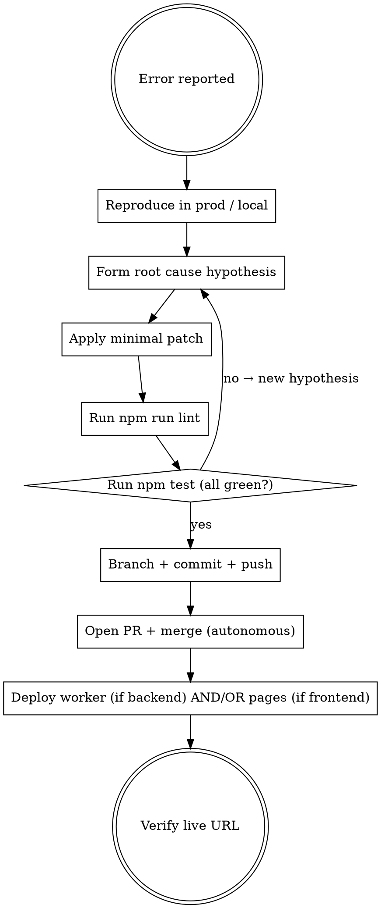

# Production Bug Fix in gametuoitho

Use when the user reports a bug from prod (4xx/5xx error in console, broken UI on the deployed site, unexpected behavior reported by a tester). Bug must be fixed end-to-end: root cause → patch → lint → test → PR → merge → deploy → live verify. **Merging without deploying is a half-fix — the user will report the same bug tomorrow.**

## When to Use

- Browser console / Network tab shows an error from `gametuoitho.space` (4xx, 5xx, unexpected JS error, infinite spinner).
- Tester reports a broken flow on the live site.
- A prod-only behavior differs from local dev (race condition, missing header, env var mismatch).

## When NOT to Use

- Pre-commit bugs caught locally before deploy.
- Refactoring or feature work (use the `adding-new-view` skill instead).
- Infrastructure outages (CF status page, D1 quota exceeded) — surface, don't patch.

## Phase 1 — Root Cause (required before any patch)

Use `superpowers:systematic-debugging`. **No fixes without root cause + minimal repro in hand.**



## Patch Discipline

**The Iron Law**

```
NO FIX WITHOUT ROOT CAUSE. NO MERGE WITHOUT DEPLOY. NO "FIX LOCAL ONLY" STOPPING POINT.
```

- **One variable at a time.** Don't bundle unrelated refactors into the bug-fix PR.
- **No "while I'm here" improvements.** Spotted a separate bug? Note it, file a follow-up PR — don't fix in this commit.
- **No new dependencies.** Unless the bug is "library X has bug Y" and a bump fixes it (rare).
- **Don't edit `src/lib/api.ts` casually.** It's used by every frontend fetch; changes ripple wide.

## Pipeline (autonomous per project memory)

1. **Patch** the smallest possible change that addresses the root cause.
2. **Lint**: `npm run lint` → 0 errors.
3. **Test**: `npm test` → all green. If you changed an endpoint contract, **update the test** to assert the new shape (and assert no secret fields leak — e.g. `code`).
4. **Branch**: `git checkout -b fix/<scope>` (e.g. `fix/bilac-first-fetch-401`).
5. **Commit** with conventional message: `fix(<scope>): <symptom> (root cause)`.
6. **Push**: `git push -u origin fix/<scope>`.
7. **PR**: `gh pr create` with body including root cause + fix + verification.
8. **Merge**: `gh pr merge --merge --delete-branch` (autonomous — don't ask).
9. **Sync main**: `git checkout main && git fetch origin main && git reset --hard origin/main` (local main diverges often — origin is source of truth).
10. **Deploy** (in this order; order matters for backend changes):
    - Worker first if backend touched: `cd worker && npx wrangler@3.114.17 deploy`.
    - D1 only if `worker/migrations/` has a new `.sql`: `cd worker && npx wrangler@3.114.17 d1 migrations apply gametuoitho-db --remote`.
    - Frontend last if UI touched: `npm run build:fe && npx wrangler@3.114.17 pages deploy dist --project-name gametuoitho --branch main`.
11. **Verify live** (mandatory — never claim fixed without this):
    - `curl -s "https://gametuoitho.space/<segment>?cb=$RANDOM" | grep -oE '/assets/index-[A-Za-z0-9_-]+\.js'` must match `dist/assets/index-*.js`.
    - `curl -s -o /dev/null -w "%{http_code}\n" "https://gametuoitho.space/<relevant-path>"` for the affected endpoint or page.
    - Spot-check the new code is in the minified bundle: `curl -s <bundle> | grep -c '<expected-literal>'`.
    - For UI fixes: navigate the live URL in the browser and confirm the original symptom is gone. Use the browser MCP tools for snapshot + screenshot.

## Gotchas

- **Wrangler pin**: `npx wrangler@3.114.17` only. Unpinned 4.x reads `worker/wrangler.toml` incorrectly and fails with "Missing entry-point".
- **Pages CDN cache**: apex HTML may still point at the old bundle hash for a few minutes after deploy. Asset URLs go live immediately. Hard refresh / incognito will pick up the new HTML.
- **TSX/sandbox UID**: in restricted bash, `UID=...` triggers `failed to change user ID`. Use `bash -c 'U=foo; ...'` or a non-reserved var name.
- **Frontend-only bug**: deploy Pages only. Don't re-run `wrangler deploy`. Don't write tests for it unless the bug warrants regression coverage.
- **Backend-only bug**: deploy Worker only. Skip `npm run build:fe`. **Never** wrap a backend fix in a frontend rebuild — wastes 60s, confuses deploy hashes.
- **PR title**: keep under 70 chars; body shows root cause + fix + verification. Use plain markdown.

## Common Rationalizations (all wrong)

| Excuse | Reality |
|---|---|
| "Bug is obvious, skip Phase 1" | Obvious bugs have root causes too. 5 min reading > 30 min guessing. |
| "Local test passed, just merge" | Local ≠ prod. CDN cache, missing header, env var — verify live. |
| "Deploy is slow, skip and report" | User reports the same bug tomorrow. Always deploy. |
| "Bundle unrelated cleanup in this PR" | Smallest diff. Separate concern = separate PR. |
| "D1 schema unchanged, skip migration" | Correct, but check `worker/migrations/` for any new `.sql` before claiming unchanged. |
| "Pages hash matches dist" | HTML cache may still be stale. Check asset URL, not just bundle filename. |

## Quick Reference

```bash
# Full bug-fix loop
git checkout -b fix/<scope>
# ... edit ...
npm run lint && npm test
git add <files>
git commit -m "fix(<scope>): <symptom>"
git push -u origin fix/<scope>
gh pr create --base main --head fix/<scope> --title "fix(<scope>): ..." --body "## Why\n...\n## Fix\n...\n## Verify\n..."
gh pr merge --merge --delete-branch
git checkout main && git reset --hard origin/main

# Deploys (run only what's needed)
cd worker && npx wrangler@3.114.17 deploy                                            # backend
cd worker && npx wrangler@3.114.17 d1 migrations apply gametuoitho-db --remote       # if new migration
npm run build:fe && npx wrangler@3.114.17 pages deploy dist --project-name gametuoitho --branch main  # frontend

# Live verify
curl -s "https://gametuoitho.space/?cb=$RANDOM" | grep -oE '/assets/index-[A-Za-z0-9_-]+\.js'
```

## Reference

- `superpowers:systematic-debugging` — Phase 1 discipline.
- `.claude/skills/adding-new-view.md` — feature workflow (different scope).
- `.claude/skills/deploy-frontend/` + `deploy-worker/` — deploy gotchas.
- `CLAUDE.md` — D1 budget, env vars, port collision notes.
